<p align="center">
  
</p>

<p align="center">
  <a href="https://github.com/ImSammyTTV/Lightroom-Control-Deck/releases/latest"></a>
  <a href="https://github.com/ImSammyTTV/Lightroom-Control-Deck/actions/workflows/ci.yml"></a>
  
  
  
  <a href="LICENSE"></a>
</p>

<p align="center">
  <b>Lightroom Control Deck</b> turns your Elgato Stream Deck into a hands-on control surface for Lightroom Classic.<br>
  Flag, rate and tag from the keys, then ride the Develop sliders and colour wheels on the dials,
  with the live value shown on the deck.
</p>

<p align="center">
  <a href="https://github.com/ImSammyTTV/Lightroom-Control-Deck/releases/latest"><b>⬇️ Download</b></a> ·
  <a href="#-quick-start"><b>🚀 Quick start</b></a> ·
  <a href="#-how-it-works"><b>⚙️ How it works</b></a> ·
  <a href="#-the-banks"><b>🗂️ Banks</b></a> ·
  <a href="#-help"><b>❓ Help</b></a> ·
  <a href="https://github.com/ImSammyTTV/Lightroom-Control-Deck/issues/new"><b>🐛 Report a bug</b></a>
</p>

---

## ✨ Features

<table>
<tr>
<td width="50%" valign="top">

### 🗂️ Six banks of controls
Sort, Tone, Balance, Colour, Detail and Shape. A Bank key on every page jumps to the next, so each job gets the whole deck.

</td>
<td width="50%" valign="top">

### 🎚️ About 140 Develop sliders
Exposure to HSL, colour grading, lens corrections, transform and calibration. Turn a dial to move a slider, push to reset it.

</td>
</tr>
<tr>
<td valign="top">

### 🎨 Colour grading wheels
One dial per wheel (shadows, midtones, highlights, global). Push to cycle hue, saturation and luminance, tap to reset.

</td>
<td valign="top">

### 🚩 Cull without the mouse
Pick, reject, stars, colour tags and next/previous photo from keys. A Browse dial steps through the shoot, sets stars or tags, or zooms the loupe.

</td>
</tr>
<tr>
<td valign="top">

### 🖼️ Live values on the deck
Keys light up for the current flag, stars and tag. Dial cards on the touch strip show each slider's value as you move it.

</td>
<td valign="top">

### ✂️ Crop on a dial
Turn to pick an aspect ratio (1:1 to 16:9), push to apply a centred crop, tap to clear it.

</td>
</tr>
<tr>
<td valign="top">

### ⚡ Quick Apply
A key that applies a develop preset, adds the photo to a collection or adds a keyword, by name.

</td>
<td valign="top">

### 🎛️ Layouts for every deck
Ready-made profiles for the Stream Deck +, + XL, XL, original (MK.2), Neo and Mini. Decks without dials get nudge keys instead.

</td>
</tr>
</table>

> [!NOTE]
> **Everything stays on your computer.** No accounts, no servers and no internet needed. The deck talks to Lightroom over
> two local ports (`127.0.0.1`, 53110 and 53112).

---

## 🚀 Quick start

You need two parts: the **Stream Deck plugin**, and a small **bridge** that runs inside Lightroom so the deck can talk to it.

1. **Download** both from the [latest release](https://github.com/ImSammyTTV/Lightroom-Control-Deck/releases/latest),
   or [build them yourself](#-for-developers).
2. **Install the Stream Deck plugin.** Double-click `Lightroom-Control-Deck.streamDeckPlugin`. A profile for each
   Stream Deck model installs with it.
3. **Install the bridge.** Copy `LightroomControlDeckBridge.lrdevplugin` into Lightroom's modules folder:

   | System | Folder |
   |---|---|
   | **Windows** | `%APPDATA%\Adobe\Lightroom\Modules\` |
   | **Mac** | `~/Library/Application Support/Adobe/Lightroom/Modules/` |

4. **Restart Lightroom Classic.** Check **File → Plug-in Extras → Lightroom Control Deck: Status**. It should say the
   deck is connected.
5. **Pick the profile.** In the Stream Deck app, choose **Lightroom Control Deck** for your device, select a photo in
   Lightroom, and press a key.

> [!TIP]
> New to it? Start on the **Sort** bank with a few photos you don't mind changing. Pick, rate and tag a couple, then try
> an Exposure dial in **Tone**. Undo is on a key in every bank.

---

## ⚙️ How it works

```text
Stream Deck  ──▶  Control Deck plugin  ──▶  local ports 53110 / 53112  ──▶  Lightroom bridge  ──▶  Lightroom Classic
 keys, dials      commands + live values       (127.0.0.1 only)              (Lua plug-in)           Develop, Library
```

1. A key or dial sends a short command, like `adj:Exposure2012:5` or `cmd:pick`.
2. The bridge, running inside Lightroom, runs it with Lightroom's own plug-in API (the same calls other plug-ins use).
3. The bridge sends back the photo's flag, stars, tag and current module, plus the value of any slider the deck is
   showing, so the keys and dial cards always match what you see on screen.

The icons, manifest, settings pages and per-device layouts are all generated from a handful of data files in
`plugin/scripts`, so adding a slider or changing a layout is a small edit.

---

## 🗂️ The banks

| Bank | What it's for |
| --- | --- |
| **Sort** | Pick, reject, stars, colour tags, next and previous photo, loupe, grid, compare and survey views |
| **Tone** | Exposure, contrast, highlights, shadows, whites, blacks, dehaze and tone curve on dials, with undo, auto tone, before/after, snapshots and copy/paste settings on keys |
| **Balance** | Temperature, tint, auto white balance, vibrance, saturation, profile and HDR sliders |
| **Colour** | Colour grading wheels, HSL hue/saturation/luminance and B&W mix |
| **Detail** | Texture, clarity, sharpening, noise reduction and lens corrections, plus heal, red-eye and brush tools |
| **Shape** | Crop with aspect ratios on the Frame dial, Upright, transform sliders, and gradient and brush tools |

### The actions

| Action | Use it for |
| --- | --- |
| **Key** | Any Lightroom command: flag, rate, tag, move, change view or module, undo and more |
| **Fader** | Any Develop slider on a dial. Turn to move, push to reset |
| **Nudge Key** | A slider up or down from a key. Hold to keep going |
| **Grade Wheel** | A colour grading wheel on one dial. Push to cycle hue, saturation and luminance |
| **Browse Dial** | Browse and flag, set stars, set a colour tag or zoom the loupe |
| **Frame Dial** | Turn to choose an aspect ratio, push to apply the crop, tap to clear it |
| **Quick Apply** | A develop preset, collection or keyword, by name |
| **Bank Key** | Jump to a bank |

Every action can also be dropped onto any key or dial yourself from the **Lightroom Control Deck** category in the
Stream Deck app, so the ready-made pages are a starting point.

---

## 🔌 Lightroom bridge

Lightroom Classic can't be driven from outside, so a small plug-in inside it listens for the deck. Plug-ins only load
when Lightroom starts, so **restart Lightroom after installing or updating the bridge**.

> [!NOTE]
> Lightroom switches a plug-in off by itself if it errors while loading. If the deck stops responding, open
> **File → Plug-in Manager** and check **Lightroom Control Deck Bridge** is enabled.

A modal dialog open in Lightroom (export, an alert) pauses the bridge until you close it.

**Checked against a live Lightroom Classic:** flags, stars, colour tags, module switching, Develop and colour-wheel sliders, all eight crop ratios (the crop edges come out at the right aspect ratio), Upright (Auto, Level, Vertical and Full), B&W mix, and the mask tone sliders. The mask tools (brush, linear and radial gradient, and the AI subject, sky and background masks) create masks without error. **Not checked:** Guided Upright, which needs lines drawn by hand, and the People, Objects and Landscape masks. If something misbehaves, [open an issue](https://github.com/ImSammyTTV/Lightroom-Control-Deck/issues/new).

---

## ❓ Help

<details>
<summary><b>Keys flash an alert triangle</b></summary>

The bridge isn't connected. In Lightroom, open **File → Plug-in Extras → Lightroom Control Deck: Status**. If the menu
item isn't there, the bridge folder is in the wrong place, or Lightroom needs a restart.
</details>

<details>
<summary><b>I updated the bridge but nothing changed</b></summary>

Quit Lightroom fully and open it again. Plug-ins load at launch.
</details>

<details>
<summary><b>Stream Deck won't install an update</b></summary>

Stream Deck skips a plug-in with the same version number as the one installed. Releases always bump it; if you built it
yourself, raise `version` in `plugin/scripts/brand.mjs` and rebuild.
</details>

<details>
<summary><b>The sliders do nothing</b></summary>

Slider keys and dials need a photo selected. The deck switches to the Develop module for you the first time you move one.
</details>

<details>
<summary><b>The clear-tag key toggles instead of clearing</b></summary>

Lightroom's plug-in API has no "remove colour label" call, so the key toggles off whichever colour the photo
currently has. If the photo has no tag, it does nothing.
</details>

<details>
<summary><b>Where are the logs?</b></summary>

The Stream Deck plugin writes to `Plugins/com.lightroom-control-deck.sdPlugin/logs/` in the Stream Deck folder.
The bridge writes warnings to `LrClassicLogs/LightroomControlDeckBridge.log` in Lightroom's logs folder.
</details>

🐛 **Found a bug or have an idea?** [Open an issue](https://github.com/ImSammyTTV/Lightroom-Control-Deck/issues/new).

---

## 🛠️ For developers

<details>
<summary><b>Building from source</b></summary>

```bash
cd plugin
npm ci
npm run build        # generates icons, settings pages and profiles, then bundles the plugin
npx streamdeck validate com.lightroom-control-deck.sdPlugin
npx streamdeck pack com.lightroom-control-deck.sdPlugin --output ..
```

Every push builds, validates and packages the plugin on GitHub Actions (`.github/workflows/ci.yml`) and checks that the
bridge's Lua parses.

</details>

<details>
<summary><b>Layout</b></summary>

| Folder | What it is |
|---|---|
| `plugin/` | The Stream Deck plugin (TypeScript, bundled with rollup) and the generators for its icons, manifest and profiles |
| `plugin/scripts/` | The data and generators: actions, layouts, sliders, icons and profiles |
| `plugin/src/` | The plugin itself: bridge client, renderers for keys and dial cards, and the actions |
| `bridge/` | The Lightroom Classic plug-in (Lua) |
| `assets/` | The banner used in this README |
</details>

---

<p align="center">
  Made with 💙 for photographers · <a href="LICENSE">MIT License</a><br>
  <sub>Lightroom and Adobe are trademarks of Adobe. Stream Deck is a trademark of Elgato. This project isn't affiliated with or endorsed by either.</sub>
</p>
